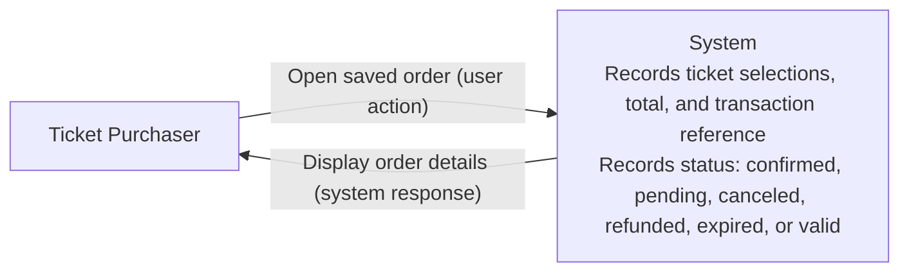
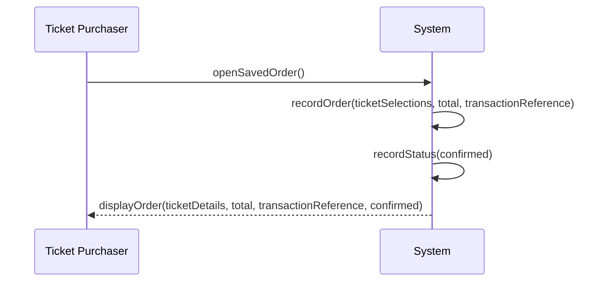

##Mermaid Diagram for UC-01 

##Mermaid Sequence Diagram

        
1.The system records the order’s ticket selections, total, and transaction reference.\
2.The system determines and records the order’s status as confirmed.\
3.The ticket purchaser opens the saved order.\
4.The system displays the ticket details, total, transaction reference, and current status.\
Extensions:\
2a. The system determines that the order is pending. It records that status and continues at step 3.\
2b. The system determines that the order is canceled. It records that status and continues at step 3.\
2c. The system determines that the order is refunded. It records that status and continues at step 3.\
2d. The system determines that the order is expired. It records that status and continues at step 3.\
2e. The system determines that the order is valid. It records that status and continues at step 3. Issue #8
