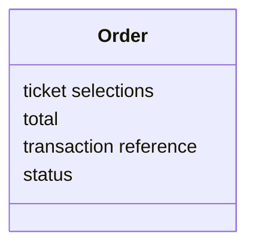
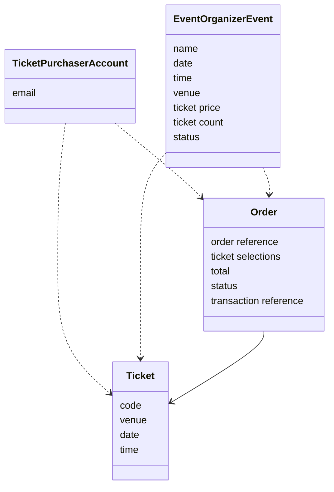

There are 5 ands; three import of ticket.py and two imports of order.py.\
Ticket.py and order.py are foundations because they are the only two files that are being imported by other python files.\
Ticket.py as the highest ranked file would change every other file were it to be removed.

1. corrected against use cases

2. corrected against code and issues

TicketPurchaserAccount -- places ----------> Order\
TicketPurchaserAccount -- owns and views --> Ticket\
EventOrganizerEvent    -- saves and views --> Order\
EventOrganizerEvent    -- has ------------> Ticket\
Order                  -- contains -------> Ticket

3. Ranking:

| Rank | File | Imports | Imported by |
|------|------|---------|-------------|
| 1 | ticket.py | 0 | 3 |
| 2 | order.py | 1 | 2 |
| 3 | ticket_purchaser_account.py | 2 | 0 |
| 4 | event_organizer_event.py | 2 | 0 |

Files importing ticket.py:\
ticket_purchaser_account.py\
event_organizer_event.py\
order.py

Files importing order.py:\
ticket_purchaser_account.py\
event_organizer_event.py

4. Hand count and command used:\
   command ran: grep -rnE "^(import|from) " --include="*.py"
